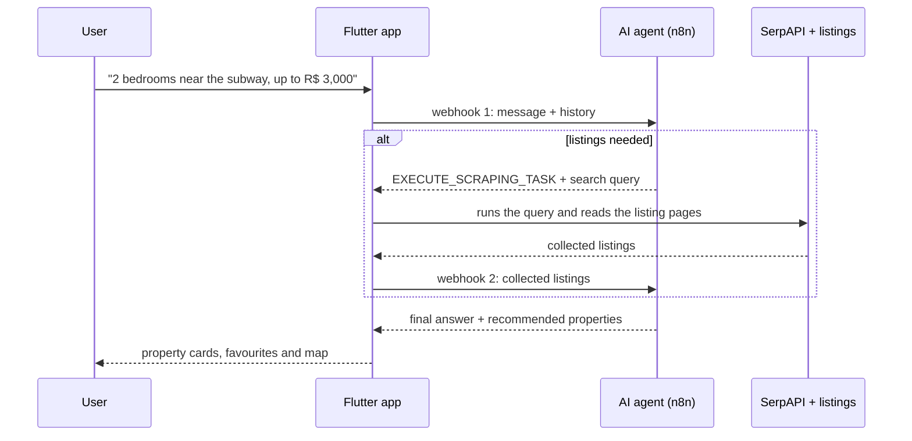

# UrbanAI

[Português](README.md) · **English**

A mobile app (Flutter + Firebase) for **conversational property search**: the user describes what they want in plain language, and an AI agent orchestrated in **n8n** decides when to fetch real listings, analyses them and answers with recommendations.

> 5th-semester integrated project, B.Sc. Computer Science, Instituto Mauá de Tecnologia (IMT), Brazil. The app's interface is in Brazilian Portuguese.

---

## How it works



The agent decides and the app executes: n8n returns a **structured action** (`action_tag` + query) instead of free text, the app runs the search and sends the data back for the agent to finish. It is the same *tool-calling* pattern as LLM agents, built with two webhooks.

| Piece | Where |
|---|---|
| Talking to the agent (both webhooks) | [`lib/services/user_services.dart`](lib/services/user_services.dart) |
| Listing search and page reading (SerpAPI + pages) | [`lib/scripts/ScrapeScript.dart`](lib/scripts/ScrapeScript.dart) |
| Sign-in (email and Google) and user data | [`lib/services/auth_service.dart`](lib/services/auth_service.dart), [`lib/services/firestore_service.dart`](lib/services/firestore_service.dart) |
| Screens: chat, favourites, map, settings | [`lib/pages/`](lib/pages/) |

---

## Stack

| Layer | Technologies |
|---|---|
| App | Flutter (Dart), Material |
| Backend | Firebase Authentication (email and Google Sign-In), Cloud Firestore (profile and chat history) |
| AI and automation | AI agent in an n8n workflow, triggered by webhooks |
| External data | SerpAPI (search) and listing-page reading; Google Maps and Geocoding for the map |

The n8n workflow (agent prompt and nodes) runs outside this repository.

---

## Run it

Requires [Flutter](https://docs.flutter.dev/get-started/install) (Dart 3.7+), a Firebase project, a SerpAPI key and the published n8n workflow.

```bash
git clone https://github.com/pgmaximo/S5_ProjetoIntegrador_UrbanAI.git
cd S5_ProjetoIntegrador_UrbanAI
flutter pub get

# 1. Firebase: generates lib/firebase_options.dart
flutterfire configure

# 2. Keys: copy the template and fill it in (the real file is git-ignored)
cp lib/scripts/secret.example.dart lib/scripts/secret.dart
touch lib/scripts/.env

flutter run
```

---

## Team

Built by Pedro Gabriel Oliveira Máximo, Arturo Ochoa Garcia and Brunno Bernacchi de Souza.
