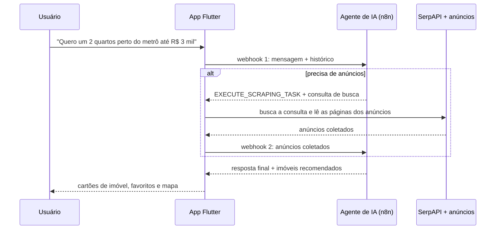

# UrbanAI

**Português** · [English](README.en.md)

App mobile (Flutter + Firebase) de **busca de imóveis por conversa**: o usuário descreve o que procura em linguagem natural e um agente de IA orquestrado no **n8n** decide quando buscar anúncios reais, analisa os resultados e responde com recomendações.

> Projeto Integrador do 5º semestre de Ciência da Computação, Instituto Mauá de Tecnologia (IMT).

---

## Como funciona



A decisão fica com o agente, e a execução fica no app: o n8n devolve uma **ação estruturada** (`action_tag` + consulta) em vez de texto livre, o app executa a busca e devolve os dados para o agente concluir. É o mesmo padrão de *tool calling* dos agentes de LLM, implementado com dois webhooks.

| Peça | Onde |
|---|---|
| Conversa com o agente (os dois webhooks) | [`lib/services/user_services.dart`](lib/services/user_services.dart) |
| Busca e leitura de anúncios (SerpAPI + páginas) | [`lib/scripts/ScrapeScript.dart`](lib/scripts/ScrapeScript.dart) |
| Login (e-mail e Google) e dados do usuário | [`lib/services/auth_service.dart`](lib/services/auth_service.dart), [`lib/services/firestore_service.dart`](lib/services/firestore_service.dart) |
| Telas: conversa, favoritos, mapa, configurações | [`lib/pages/`](lib/pages/) |

---

## Stack

| Camada | Tecnologias |
|---|---|
| App | Flutter (Dart), Material |
| Backend | Firebase Authentication (e-mail e Google Sign-In), Cloud Firestore (perfil e histórico de conversas) |
| IA e automação | Agente de IA em workflow do n8n, acionado por webhooks |
| Dados externos | SerpAPI (busca) e leitura das páginas de anúncio; Google Maps e Geocoding para o mapa |

O workflow do n8n (prompt do agente e nós) roda fora deste repositório.

---

## Como executar

Pré-requisitos: [Flutter](https://docs.flutter.dev/get-started/install) (Dart 3.7+), um projeto no Firebase, uma chave da SerpAPI e o workflow do n8n publicado.

```bash
git clone https://github.com/pgmaximo/S5_ProjetoIntegrador_UrbanAI.git
cd S5_ProjetoIntegrador_UrbanAI
flutter pub get

# 1. Firebase: gera lib/firebase_options.dart
flutterfire configure

# 2. Chaves: copie o modelo e preencha (o arquivo real está no .gitignore)
cp lib/scripts/secret.example.dart lib/scripts/secret.dart
touch lib/scripts/.env

flutter run
```

---

## Equipe

Desenvolvido por Pedro Gabriel Oliveira Máximo, Arturo Ochoa Garcia e Brunno Bernacchi de Souza.
